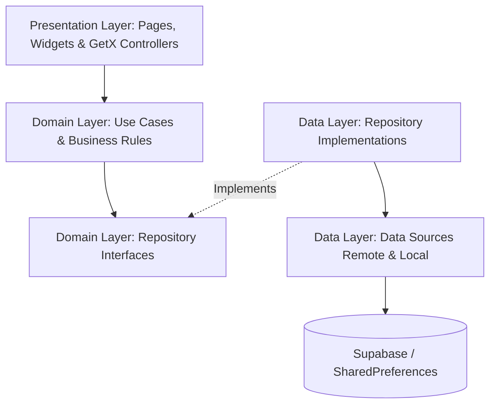

# 🎨 منصة المصممين | Designers Platform

<div align="center">

  
  &nbsp;&nbsp;&nbsp;&nbsp;
  

  <br/><br/>

  **منظومة رقمية متكاملة لربط المصممين المبدعين بالعملاء مع نظام إشرافي ومحادثات فورية**  
  *An Enterprise-grade Flutter Marketplace Platform Connecting Designers, Clients & Supervisors.*

  <br/>

  [](https://flutter.dev)
  [](https://dart.dev)
  [](https://supabase.com)
  [](https://blog.cleancoder.com)
  [](https://pub.dev/packages/get)
  [](LICENSE)

</div>

---

## 📑 فهرس المحتويات (Table of Contents)

- [نظرة عامة على المشروع (Overview)](#-نظرة-عامة-على-المشروع-overview)
- [أدوار النظام (Platform Roles)](#-أدوار-النظام-platform-roles)
- [أبرز المميزات (Core Features)](#-أبرز-المميزات-core-features)
- [الهندسة البرمجية ونمط التصميم (Architecture & Design Pattern)](#-الهندسة-البرمجية-ونمط-التصميم-architecture--design-pattern)
- [حزمة التقنيات والمكتبات (Tech Stack)](#-حزمة-التقنيات-والمكتبات-tech-stack)
- [هيكل المشروع (Directory Structure)](#-هيكل-المشروع-directory-structure)
- [إدارة الأخطاء وحالات التحميل (Error Handling & UI States)](#-إدارة-الأخطاء-وحالات-التحميل-error-handling--ui-states)
- [دليل التثبيت والتشغيل (Getting Started)](#-دليل-التثبيت-والتشغيل-getting-started)
- [المساهمة والترخيص (License & Contact)](#-المساهمة-والترخيص-license--contact)

---

## 💡 نظرة عامة على المشروع (Overview)

**منصة المصممين (Designers Platform)** هي تطبيق محمول متعدد الأدوار مبني بأحدث معايير **Flutter** و **Clean Architecture** مع خلفية سحابية قوية مدعومة بـ **Supabase**. يهدف التطبيق إلى رقمنة سوق التصميم من خلال توفير بيئة عمل آمنة، احترافية، ومرنة تتيح للمصممين استعراض سابقة أعمالهم، وللعملاء طلب ومتابعة التصاميم بسهولة، مع وجود دور إشرافي (Supervisor) يضمن جودة الخدمة وسلامة المعاملات.

---

## 👥 أدوار النظام (Platform Roles)

تم تصميم التطبيق وفق نموذج تحكم بالصلاحيات (RBAC - Role Based Access Control) يشمل ثلاثة أطراف رئيسية:

| الدور | الوصف والمسؤوليات |
| :--- | :--- |
| **👤 العميل (Client)** | استعراض المصممين والأعمال، البحث والفلترة حسب التخصص، تقديم طلبات تصميم مخصصة، التواصل الحي في غرف الدردشة الخاصة بالطلب، تقييم المصممين، وإدارة المفضلة. |
| **🎨 المصمم (Designer)** | بناء ملف شخصي احترافي (Portfolio)، رفع واستعراض الأعمال والإحصائيات، إدارة الطلبات الواردة وتحديث مراحلها، تسليم الملفات النهائية، والدردشة مع العملاء. |
| **🛡️ المشرف (Supervisor)** | لوحة تحكم إشرافية، مراجعة وتدقيق الطلبات المعلقة، مراقبة الجودة وفض النزاعات لضمان تجربة عادلة لكلا الطرفين. |

---

## ✨ أبرز المميزات (Core Features)

### 🔐 1. المصادقة وإدارة الحسابات (Authentication & Profiles)
- تسجيل دخول وإنشاء حساب مخصص لكل دور (عميل / مصمم / مشرف).
- استعادة كلمة المرور وإدارة الجلسات باستخدام Supabase Auth و JWT Tokens.
- رفع وتحديث الصورة الشخصية (Avatar) والبيانات الشخصية.

### 💼 2. استعراض الأعمال والملف الشخصي (Portfolio & Profiles)
- واجهة ملف شخصي ديناميكية للمصمم تتضمن إحصائيات حية (عدد الأعمال، الطلبات المنجزة، التقييم العام).
- معرض أعمال تفاعلي (Grid Showcase) مع عارض صور محسّن ومخزن مؤقتاً.
- نظام تقييمات ومراجعات شفافة من العملاء.

### 📦 3. إدارة دورة حياة الطلبات (Order Lifecycle Management)
- تدفق عمل كامل لإدارة الطلب: `جديد` ➔ `قيد التنفيذ` ➔ `مكتمل / قيد المراجعة` ➔ `تم التسليم`.
- صفحة تفاصيل الطلب مع عرض البيانات، المرفقات، ومواعيد التسليم.
- ربط مباشر بين الطلب وغرفة المحادثة الخاصة به.

### 💬 4. الدردشة والتواصل الفوري (Real-Time Order Chat)
- غرف محادثة مخصصة لكل طلب مبنية على **Supabase Realtime**.
- إمكانية تبادل الرسائل النصية ورفع الملفات والتصاميم أثناء سياق الطلب.
- تحديث فوري لحالات القراءة ومؤشرات الوقت.

### 🛡️ 5. لوحة الإشراف وضمان الجودة (Supervisor Quality Control)
- قائمة بالطلبات المعلقة تتطلب اعتماد المشرف (Pending Approval).
- لوحة تحكم إحصائية Dashboard لمراقبة أداء المنصة وسير الطلبات.

### 🔍 6. محرك بحث وفلترة ذكي (Smart Search & Discovery)
- بحث سريع متعدد المعايير يشمل البحث عن المصممين وعن الأعمال المنشورة.
- تصنيفات وتصفية سريعة تسهل وصول العميل للمصمم الأنسب.

---

## 🏛️ الهندسة البرمجية ونمط التصميم (Architecture & Design Pattern)

تم بناء المشروع بالاعتماد على **Clean Architecture** باتباع مبادئ **SOLID**، حيث تم فصل الشيفرة البرمجية إلى طبقات مستقلة تماماً وقابلة للاختبار (Testable & Decoupled):



### 1. طبقة العرض (Presentation Layer):
- استخدام **GetX** لإدارة الحالة الخفيفة وفصل منطق الواجهة عن المتحكمات (Controllers).
- دعم التصميم التجاوبي لجميع مقاسات الشاشات باستخدام `flutter_screenutil`.
- اعتماد الثيم الداكن والفاتح ومراعاة كاملة للغة العربية والخطوط المخصصة (`doran`, `adobe_arabic`, `iosRounded`).

### 2. طبقة النطاق (Domain Layer):
- تمثل قلب التطبيق المستقل تماماً عن أي إطار عمل أو حزم خارجية.
- تضم الـ **Entities** ونماذج الأعمال، وواجهات المستودعات (Repository Interfaces)، و **Use Cases** مفردة المسؤولية (Single Responsibility Principle).

### 3. طبقة البيانات (Data Layer):
- تضم **Models** القابلة للتحويل من وإلى JSON / Supabase Data.
- تطبيقات المستودعات (Repositories Implementations) التي تدير تدفق البيانات وتتعامل مع الـ DataSources.
- استخدام **Dartz** ونمط البرمجة الوظيفية `Either<Failure, T>` للتعامل مع الأخطاء بدون رمي استثناءات غير متوقعة.

---

## 🛠️ حزمة التقنيات والمكتبات (Tech Stack)

| المجال / الغرض | التقنية / الحزمة | الاستخدام والوظيفة |
| :--- | :--- | :--- |
| **Framework** | [Flutter](https://flutter.dev) (v3.6+) | إطار العمل الرئيسي لتطوير التطبيق لأنظمة Android & iOS |
| **Backend & Database** | [Supabase Flutter](https://supabase.com) | قاعدة بيانات PostgreSQL، مصادقة المستخدمين، التخزين السحابي والتواصل اللحظي |
| **State Management** | [GetX](https://pub.dev/packages/get) | إدارة الحالة التفاعلية (Reactive State)، والتوجيه (Navigation)، وحقن التبعيات (DI) |
| **Functional Error Handling** | [Dartz](https://pub.dev/packages/dartz) | تطبيق نمط البرمجة الوظيفية `Either<Failure, Success>` لضمان استقرار التطبيق |
| **Responsive UI** | [flutter_screenutil](https://pub.dev/packages/flutter_screenutil) | تكييف مقاسات النصوص والعناصر لتناسب مختلف أبعاد الشاشات بدقة |
| **Shimmer & Skeletons** | [skeletonizer](https://pub.dev/packages/skeletonizer) | توفير هياكل تحميل جمالية تفاعلية تعزز تجربة المستخدم أثناء جلب البيانات |
| **Network & Image Cache** | [cached_network_image](https://pub.dev/packages/cached_network_image) | التخزين المؤقت للصور وتفادي إعادة التحميل لتحسين الأداء |
| **Network Connectivity** | [internet_connection_checker](https://pub.dev/packages/internet_connection_checker) | التحقق الذكي من توفر الاتصال بالإنترنت قبل تنفيذ العمليات السحابية |
| **Typography & Icons** | [font_awesome_flutter](https://pub.dev/packages/font_awesome_flutter) + Custom Fonts | خطوط عربية وتصميمات أيقونات متميزة لدعم الهوية البصرية |

---

## 📂 هيكل المشروع (Directory Structure)

يتبع المشروع تنظيم **Feature-First Clean Architecture**:

```text
lib/
├── core/                               # العناصر المشتركة لكامل التطبيق
│   ├── data/                           # مصادر البيانات العامة
│   ├── domain/                         # الكيانات العامة
│   ├── error/                          # تعريفات الـ Failures و Exceptions
│   ├── network/                        # التحقق من الاتصال بالإنترنت
│   ├── presentation/                   # الودجات والعناصر المشتركة
│   ├── routes/                         # المسارات والتنقل بين الصفحات
│   ├── service/                        # الخدمات العامة
│   ├── usecase/                        # معيار الـ Base UseCase
│   └── utils/                          # الألوان، الثيمات، والثوابت
├── features/                           # وحدات وميزات النظام
│   ├── auth/                           # نظام المصادقة وتسجيل الدخول
│   ├── home/                           # الشاشة الرئيسية وعرض الأعمال
│   ├── order_management/               # دورة حياة الطلبات والدردشة الفورية
│   │   ├── data/                       # Models, Repositories, DataSources
│   │   ├── domain/                     # Entities, Use Cases, Interfaces
│   │   └── presentation/               # Pages, Widgets, GetX Controllers
│   ├── designer_profile/               # الملف الشخصي للمصمم ومعرض الأعمال
│   ├── customer_profile/               # الملف الشخصي للعميل وقائمة المفضلة
│   ├── search/                         # البحث الذكي والفلترة
│   ├── supervisor/                     # لوحة تحكم المشرف وإدارة الطلبات
│   └── completion/                     # إجراءات تسليم وإتمام الطلبات
├── injection.dart                      # إدارة وحقن التبعيات (Dependency Injection)
└── main.dart                           # نقطة انطلاق التطبيق وإعداد البيئة
```

---

## 🛡️ إدارة الأخطاء وحالات التحميل (Error Handling & UI States)

- **Functional Failure Pattern**: استخدام كلاس `Failure` مع تقسيم واضح:
  - `ServerFailure`: لأخطاء الخادم وقواعد البيانات.
  - `OfflineFailure`: عند انقطاع الاتصال بالإنترنت.
  - `UnauthorizedFailure`: عند انتهاء صلاحية الجلسة.
- **Loading UX**: توظيف `Skeletonizer` بدلاً من مؤشرات التحميل الدائرية التقليدية، مما يمنح التطبيق طابع التطبيقات العالمية مثل Instagram و Twitter.

---

## 🚀 دليل التثبيت والتشغيل (Getting Started)

### المتطلبات الأساسية (Prerequisites)
- تثبيت [Flutter SDK](https://docs.flutter.dev/get-started/install) بإصدار `>=3.6.0`.
- تثبيت محاكي Android أو iOS، أو ربط جهاز فعلي.
- مشروع فعال على منصة [Supabase](https://supabase.com).

### خطوات التشغيل (Installation Steps)

1. **استنساخ المستودع (Clone the repository):**
   ```bash
   git clone https://github.com/Abdullah-Bashaaib/designers_platform.git
   cd designers_platform
   ```

2. **تثبيت الحزم والتبعيات (Install dependencies):**
   ```bash
   flutter pub get
   ```

3. **إعداد متغيرات البيئة (Supabase Setup):**
   تأكد من تحديث بيانات الاتصال بـ Supabase داخل الملف `lib/main.dart`:
   ```dart
   await Supabase.initialize(
     url: 'YOUR_SUPABASE_PROJECT_URL',
     anonKey: 'YOUR_SUPABASE_ANON_KEY',
     authOptions: const FlutterAuthClientOptions(autoRefreshToken: true),
   );
   ```

4. **تشغيل التطبيق (Run Application):**
   ```bash
   flutter run
   ```

---

## 👨‍💻 المطور ومسؤول المشروع (Author)

**عبدالله باشعيب (Abdullah Bashaaib)**  
- **GitHub**: [@Abdullah-Bashaaib](https://github.com/Abdullah-Bashaaib)
- **Email**: [abdullah.bashaaib@example.com](mailto:abdullah.bashaaib@example.com)

---

<div align="center">
  <sub>تم بناء وتطوير المشروع بشغف باستخدام Flutter و Clean Architecture 🚀</sub>
</div>
